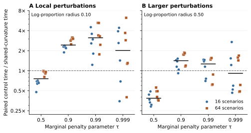

# Exploratory KL-unbalanced OT extension

Supplementary addendum for **Efficient reference composition sensitivity analysis
for single-cell annotation**, prepared 23 November 2026.

[中文说明](README_zh.md) · [Read the addendum](SUPPLEMENT.md)

## Files

| File | Purpose |
|---|---|
| [Supplementary addendum PDF](Supplementary_Addendum_Unbalanced_OT.pdf) | Eight-page methods, results, figure and numerical checks |
| [Editable Word addendum](Supplementary_Addendum_Unbalanced_OT.docx) | Same content, with native Word equations |
| [Supplementary Data U1](Supplementary_Data_U1.zip) | Six exact prepared inputs, code, all timings, development records and reproduction commands |
| [Initial configuration table](results/configuration_summary.csv) | All 96 configurations and five controls |
| [Revised configuration table](results/revised_configuration_summary.csv) | All 96 retested configurations, including slowdowns |
| [Results by penalty](results/revised_by_tau.csv) | Revised performance summaries |
| [Manifest](manifest.json) | SHA-256 checksums for the public addendum files |

## What was tested

Fixed costs, positive reference weights, product-KL entropy and symmetric KL
penalties on both marginals. Six prepared HCC/lung tasks have 307–500 queries
and 384 references. Shared factorization and first-order prediction are followed
by correction to the same log fixed-point residual tolerance as all controls.
This is a standalone Python computational prototype; the package R/Python
interface remains the balanced method. No unbalanced directed search or
review-priority ranking is claimed.

## Results

| Measure | Revised result |
|---|---:|
| Configurations faster / slower | 57 / 39 |
| Median paired audit time ratio | 1.34× |
| Median including common initialization | 1.26× |
| Local perturbations, log-proportion L2 radius 0.10 | 2.26× |
| Larger perturbations, radius 0.50 | 0.98× |
| Range over all configurations | 0.29–6.26× |
| Label disagreements with paired controls | 0 |

Time ratio is control time divided by shared-method time. Preparation,
correction, fallback and score readout are included; upstream single-cell
preprocessing and file I/O are excluded. Peak memory was not measured.
All 24 settings at τ=0.5 were slower. Numerical agreement does not establish
biological label correctness or calibrated class probabilities.



The initial comparison tested five controls and the original shared method
(1,728 timing records). After a fallback-centering revision, all 96 settings
were retested against their previously selected controls (576 records).
This is the same development dataset, not independent confirmation or a fresh
five-control competition. The complete initial record is preserved.

## Reproduce

Download and extract **Supplementary_Data_U1.zip**, then run from its root:

```sh
python -m pip install -r requirements.txt
python code/verify_record.py
python code/run_reproduction.py --output ../uot_correctness_run --mode check
# Optional complete benchmark in a new directory:
python code/run_reproduction.py --output ../uot_full_run --mode full
```

The record verifier checks hashes, timing counts, control selection and paired
medians without rerunning the benchmarks. Reproduction uses a new directory
and preserves the deposited results. The full run performs 2,304 timed calls;
absolute timings vary by hardware. The archive README explains every file,
input provenance and the distinction between numerical and biological validation.

Source data: GSE149614 and GSE135893, using the manuscript's archived prepared
matrices. HCC03N and HCC03T are samples from the same patient. Original metadata
saying “frozen held-out test” refer to the balanced-study split; these inputs
were reused for development of this UOT extension.

The separate `SU` numbering avoids changing the original submitted supplement.
The addendum does not imply journal acceptance or editorial approval. Code
follows the repository MIT license; original data and dependency terms apply.
