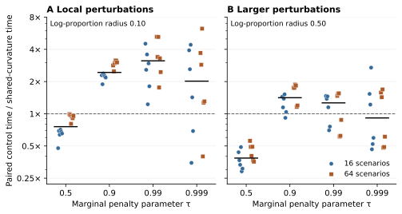

# Supplementary addendum on unbalanced optimal transport

**For the manuscript:** *Efficient reference composition sensitivity analysis for single-cell annotation*

**Prepared 23 November 2026.** Sections, tables and figures use the separate prefix SU to avoid renumbering the submitted supplement.

## SU1 Purpose and data

This exploratory computational extension asks whether shared-curvature prediction and correction can accelerate repeated reference-composition calculations when both transport marginals are relaxed using Kullback–Leibler (KL) penalties. The submitted study evaluates balanced optimal transport (OT). The extension below evaluates a separately implemented KL-unbalanced objective; it does not replace the submitted experiments or add a new disease-mechanism result.

The revised implementation was faster than its paired control in 57 of 96 configurations. The median time ratio was **1.34×**, or **1.26×** after adding common kernel construction and baseline solution time. The median was **2.26×** for local perturbations and **0.98×** for larger perturbations. All 96 configurations, including the 39 slowdowns, are retained. The revised run is a development retest on the same inputs, following a fallback change motivated by the initial run.

**Table SU1. Prepared inputs used in the extension**

| Compartment | Sample | Archived condition | Query cells | Reference cells |
|:--|:--|:--|--:|--:|
| HCC myeloid | HCC03N | Normal | 500 | 384 |
| HCC myeloid | HCC03T | Tumor | 500 | 384 |
| Lung epithelial | TILD006 | IPF | 307 | 384 |
| Lung epithelial | TILD019 | ILD | 500 | 384 |
| Lung mesenchymal | VUILD58 | cHP | 446 | 384 |
| Lung mesenchymal | VUILD55 | NSIP | 500 | 384 |

Inputs were taken from the manuscript's archived prepared matrices for GSE149614 (HCC) and GSE135893 (lung). Within each compartment, the first two files with at least 300 query cells were selected in lexicographic fold/sample order before inspecting performance. Costs, reference labels and baseline weights were reused; raw-count processing and representations were not recomputed. Exact files, metadata and SHA-256 hashes accompany Supplementary Data U1.

There are six prepared tasks, not six independent biological cohorts. HCC03N and HCC03T belong to the same patient. Parameter settings and scenario counts reuse data and directions. Archived condition abbreviations are retained to distinguish the lung samples; they are not all IPF samples.

## SU2 Objective and reduced curvature

Let $C\in\mathbb{R}^{n\times m}$ be the fixed query-by-reference cost matrix, $a_i=1/n$ the source weights, and $b_j>0$ the normalized reference weights. The extension minimizes

$$\min_{G\geq0}\;\langle C,G\rangle+\epsilon\operatorname{KL}(G\mid ab^\top)+\rho_a\operatorname{KL}(G\mathbf{1}\mid a)+\rho_b\operatorname{KL}(G^\top\mathbf{1}\mid b).\qquad(\mathrm{SU1})$$

Here $\operatorname{KL}(u\mid v)=\sum_i[u_i\log(u_i/v_i)-u_i+v_i]$. Both marginal masses can deviate from their input weights. All controls and independent checks use the same product-KL regularization convention; replacing it by negative entropy would change this unbalanced problem [1,3,4].

Define $K=\exp(-C/\epsilon)$ and $\tau_\ell=\rho_\ell/(\rho_\ell+\epsilon)$ for $\ell\in\{a,b\}$. Absorbing the input weights into log scalings gives $G=\operatorname{diag}(e^x)K\operatorname{diag}(e^y)$. Eliminating the source scaling yields

$$x(y)=\log a-\tau_a\log(Ke^y),\qquad T(y;b)=\log b-\tau_b\log(K^\top e^{x(y)}).\qquad(\mathrm{SU2})$$

The shared stopping condition is $\|T(y;b)-y\|_\infty\leq10^{-8}$. It checks the reduced stationarity equations. It does not require the transported marginals to equal $a$ and $b$, which would impose balanced constraints.

Write $r=G\mathbf{1}$, $c=G^\top\mathbf{1}$ and $s_j=b_j^{1/\tau_b}\exp[-(1-\tau_b)y_j/\tau_b]$. At a solved baseline, $c_0=s_0$. The Jacobian of $F=c-s$ at that baseline is the symmetric reduced curvature matrix

$$H_0=\frac{1}{\tau_b}\operatorname{diag}(c_0)-\tau_aG_0^\top\operatorname{diag}(r_0)^{-1}G_0.\qquad(\mathrm{SU3})$$

Weighted Cauchy–Schwarz gives $G_0^\top\operatorname{diag}(r_0)^{-1}G_0\preceq\operatorname{diag}(c_0)$, and therefore

$$H_0\succeq(1/\tau_b-\tau_a)\operatorname{diag}(c_0)\succ0.\qquad(\mathrm{SU4})$$

Finite positive penalties fix the physical scaling: the balanced gauge-fixing term is not added. Positive definiteness allows factorization but does not guarantee uniformly good conditioning as the penalties approach the balanced limit.

## SU3 Reusing a factorization across compositions

The smaller side is factored once per scenario batch. If $m\leq n$, the implementation factors $H_0$ directly. Otherwise, set $D=\operatorname{diag}(c_0/\tau_b)$ and apply the Woodbury identity:

$$A=\operatorname{diag}(r_0)/\tau_a-G_0D^{-1}G_0^\top,\qquad(\mathrm{SU5})$$

$$H_0^{-1}R=D^{-1}R+D^{-1}G_0^\top A^{-1}G_0D^{-1}R.\qquad(\mathrm{SU6})$$

The factor dimension is thus $\min(n,m)$. Let $Y$ be the reference-cell class-membership matrix, and let $p$ be normalized class proportions. Within each class, relative cell weights are preserved. Along normalized composition changes, $d\log b=Y\,d\log p$, giving

$$J_{\log p}=H_0^{-1}\operatorname{diag}(c_0/\tau_b)Y,\quad y_{\mathrm{pred}}=y_0+J_{\log p}(\log p-\log p_0).\qquad(\mathrm{SU7})$$

This pilot uses a **first-order** predictor. The submitted balanced method also evaluates a second-order variant; no second-order unbalanced speed claim is made here. The predictor is followed by frozen-curvature correction, with a numerically stable right-hand side:

$$\Delta y=H_0^{-1}(s-c),\qquad s-c=c\odot\operatorname{expm1}((T(y;b)-y)/\tau_b).\qquad(\mathrm{SU8})$$

Backtracking requires reduction of the log fixed-point residual, with up to 12 backtracks, a maximum log step of 4 and a residual-decrease coefficient of $10^{-4}$. Failed correction or the limit of 40 chord iterations triggers accelerated Sinkhorn fallback. Preparation, prediction, all corrections and fallback are included in the reported audit times.

The initial fallback used ordinary AA2. Inspection of the initial results motivated enabling scalar centering within the fallback calls. The identity

$$T(y+t\mathbf{1};b)=T(y;b)+\tau_a\tau_b t\mathbf{1}\qquad(\mathrm{SU9})$$

allows the shift $t=\operatorname{clip}(\operatorname{mean}(T-y)/(1-\tau_a\tau_b),-4,4)$, which removes the mean residual when unclipped. This changes the physical transport scaling; it is distinct from a balanced gauge normalization. Only the fallback calls changed in the revised shared implementation. Its data, predictor, factorization, iteration limit, line search and tolerances remained fixed.

## SU4 Benchmark design and timing

The grid contains six tasks, four symmetric penalty settings, two perturbation radii and two batch sizes, giving 96 configurations. The entropic parameter is $\epsilon=0.05$. Values $\tau_a=\tau_b\in\{0.5,0.9,0.99,0.999\}$ correspond to $\rho_a=\rho_b\in\{0.05,0.45,4.95,49.95\}$.

For each task, 64 Gaussian class directions were centered and scaled to unit Euclidean norm using seed 20261123. The 16-scenario batch takes the first 16 of those 64 directions. Reference weights follow $b_j\propto b_{0j}\exp(\delta d_{k(j)})$, with normalization over reference cells. Radii $\delta=0.10$ and $0.50$ refer to **centered log-proportion L2 distance**, not 10% or 50% mass changes and not matched total-variation radii. The benchmark uses these newly generated random directions, not the directed scenarios stored in the original input archives.

**Initial comparison.** Five controls were timed alongside the initial shared method: ordinary Sinkhorn, Anderson-accelerated Sinkhorn with memory two (AA2), scalar-centered Sinkhorn, scalar-centered AA2, and a batched implementation of symmetric-penalty translation-invariant Sinkhorn following Algorithm 2 of Séjourné et al. [2]. The latter restores physical potentials before the common residual check. It is a paper-based implementation, not an unmodified POT runtime benchmark. AA2 uses normalized Gram regularization 0.01 and a maximum extrapolation log step of 4.

All methods use float64 arithmetic, the same dense kernel, baseline warm starts, scenario batching and normalized class-score readout. The common baseline uses centered AA2 at tolerance $10^{-12}$. Shared preparation requires baseline residual at most $10^{-10}$. Each configuration has three timing repeats, with cyclic method ordering. All 1,728 initial solver calls completed successfully.

**Revised comparison.** For every configuration, the fastest successful control was selected from its initial three-repeat median. That fixed control and the revised shared method were then retimed with three repeats in alternating order, adding 576 calls. All 96 configurations were retested. This is not a new five-control competition or an independent held-out validation; the same inputs informed the fallback revision.

Audit time includes shared preparation and derivative computation, scenario solving, backtracking, fallback and class-score readout. The additional “with initialization” measure adds the separately measured common kernel-construction and baseline-solution times to each method's median audit time. It excludes input loading, upstream single-cell preprocessing, independent validation and output writing, and is not end-to-end single-cell workflow time. Repeats ran in one process on one pinned CPU with one BLAS/OpenMP thread; they are timing repeats, not biological replicates. No peak-memory benchmark was performed.

## SU5 Results across all configurations

**Table SU2. Overall results before and after the fallback revision**

| Measure | Initial comparison | Revised comparison |
|:--|--:|--:|
| Configurations | 96 | 96 |
| Timed solver calls | 1,728 | 576 |
| Median audit speed ratio | 1.11× | 1.34× |
| Median ratio with initialization | 1.09× | 1.26× |
| Faster / slower configurations | 51 / 45 | 57 / 39 |
| Minimum–maximum audit ratio | 0.010–5.40× | 0.29–6.26× |
| Median at radius 0.10 | 2.13× | 2.26× |
| Median at radius 0.50 | 0.54× | 0.98× |

Ratios are control time divided by shared-method time, so values above one favor the shared method. Initial ratios use the fastest of five control medians; revised ratios use the freshly timed control selected in the initial comparison. Each median summarizes configuration-level ratios, not a ratio of pooled total times. The two columns are successive development stages on the same grid.

**Table SU3. Revised results by marginal penalty**

| τ | Configurations | Median audit ratio | Median with initialization | Faster configurations |
|--:|--:|--:|--:|--:|
| 0.5 | 24 | 0.53× | 0.67× | 0 / 24 |
| 0.9 | 24 | 1.88× | 1.69× | 23 / 24 |
| 0.99 | 24 | 1.55× | 1.47× | 19 / 24 |
| 0.999 | 24 | 1.36× | 1.29× | 15 / 24 |

At $\tau=0.5$, all 24 configurations remained slower; ordinary scaling was sufficiently inexpensive that shared preparation and correction did not pay off. The benefit was clearest for local composition perturbations at intermediate or large penalties, but was not uniform. Near the balanced limit, conditioning and fallback behavior still mattered.

The two TILD006 configurations at $\tau=0.999$, radius 0.50 illustrate the fallback issue: the recorded ratios changed from 0.103× to 2.70× for 16 scenarios and from 0.091× to 1.69× for 64 scenarios. These are cross-stage diagnostic observations, not an independently randomized ablation. The complete retest, including remaining slowdowns, provides the relevant performance summary.

## SU6 Configuration-level performance

**Figure SU1. Revised shared-curvature performance across all 96 configurations.** Each point represents one task, penalty, radius and batch-size configuration. Blue circles indicate 16 scenarios; orange squares indicate 64. Black horizontal segments show the median across both batch sizes at each penalty. The dashed line marks equal time. The vertical axis is logarithmic. Panel A contains the 48 local configurations at radius 0.10; panel B contains the 48 larger-perturbation configurations at radius 0.50. Numerators are fresh timings of the control selected in the initial comparison, and denominators include shared-factor preparation, correction, fallback and score readout. Each time is the median of three repeats.

At radius 0.10, 33 of 48 configurations were faster; at radius 0.50, 24 of 48 were faster. The overall revised range was 0.29× to 6.26×. Thus, a favorable median for local changes does not imply a gain for every task, and larger changes can erase the amortization benefit.

The initial run retained a slow scalar mode in its fallback, producing severe slowdowns in some configurations. Enabling centering improved that failure mode, while 574 of 3,840 scenario occurrences still invoked fallback in the first timing repeat. Those 3,840 occurrences include overlapping 16- and 64-scenario batches and reused directions across settings; they are not independent biological observations.

## SU7 Numerical agreement and scope

Class scores are computed from actual transported row mass: $P_{ik}=(GY)_{ik}/r_i$. Dividing by the original source weights would not generally produce normalized scores in the unbalanced problem. Labels are the class-score argmax. Agreement between solvers evaluates the same numerical objective, not biological label accuracy or probability calibration.

**Table SU4. Numerical checks for the extension**

| Check | Scope | Largest recorded discrepancy |
|:--|:--|--:|
| Revised class scores vs paired control | 3,840 scenario occurrences | $5.42\times10^{-7}$ absolute |
| Revised labels vs paired control | Same occurrences | 0 disagreements |
| Revised class scores vs independent POT | 48 distinct endpoints | $5.41\times10^{-8}$ absolute |
| Revised labels vs independent POT | Same endpoints | 0 disagreements |
| Source-side vs target-side inverse | Five synthetic penalty pairs | $2.51\times10^{-14}$ relative |
| Reduced curvature vs finite differences | Same synthetic problems | $7.12\times10^{-12}$ absolute |
| Implicit predictor vs finite differences | Same synthetic problems | $4.98\times10^{-6}$ absolute |

Scenario-wide score/label comparisons use the first timing repeat of each configuration. All timing repeats record the final residual; the maximum in the revised run was $9.9998\times10^{-9}$. Independent POT checks use the first scenario of each task/penalty/radius combination, giving 48 distinct endpoints; overlapping checks for the 16- and 64-scenario batches reuse that endpoint. POT uses tolerance $10^{-13}$ with a maximum of 200,000 iterations, followed by a reduced-residual check at $10^{-10}$.

The synthetic checks use a 17-by-23 problem with seed 7193, symmetric penalty pairs at the four grid values and one asymmetric pair $(0.9,0.99)$. Central differences use step $10^{-5}$. The largest predictor finite-difference discrepancy occurs near $\tau=0.999$ and is below the $10^{-5}$ validation threshold. The synthetic shared solver uses residual tolerance $10^{-10}$; its largest absolute plan discrepancy from POT is $5.72\times10^{-12}$.

The evidence supports feasibility and conditional acceleration for repeated positive reference-weight changes at fixed costs under this KL-unbalanced objective. Speed was tested with 384 reference cells, between 307 and 500 queries, fixed entropy strength, symmetric penalties and a dense CPU kernel. It does not establish performance for changing costs, missing classes or zero weights, large atlases, GPUs, other unbalanced objectives, growth-rate pipelines, or asymmetric-penalty workloads. Directed search and review-priority ranking were not evaluated in this unbalanced extension. Additional tasks not used for development would be needed to assess generalization of the revised solver.

## SU8 Reproducibility and references

Supplementary Data U1 contains the six exact prepared inputs, both implementations, benchmark scripts, initial and revised raw timings, all 96-row summaries, numerical checks, development records, input hashes and environment information. The initial comparison is retained separately from the fallback revision. A verification script checks input hashes, configuration counts, paired medians and the reported aggregate values without rerunning the timed experiments.

The benchmark environment was Linux x86_64, AMD EPYC 9V74 80-Core Processor, Python 3.12.14, NumPy 2.3.5, SciPy 1.17.0, POT 0.9.7.post1 and OpenBLAS 0.3.30. Execution was restricted to one CPU and one BLAS/OpenMP thread. Package versions and complete recorded environment details are supplied with the archive. Exact timings may vary on other machines.

To inspect the record, unzip Supplementary Data U1 and follow its README. The delivered timing files are preserved as the original record. A reproduction command runs in a separate working directory, since the benchmark deliberately refuses to overwrite existing raw timings. Running both stages regenerates 1,728 initial and 576 revised timing records; it can take substantially longer than the numerical smoke checks.

The public repository provides an independently labeled experimental directory for this addendum. The current packaged R/Python interface continues to expose the balanced method. The unbalanced scripts are not presented as a released R interface or as a new benchmark for the existing package wrapper.

**References**

[1] Chizat L, Peyré G, Schmitzer B, Vialard F-X. Scaling algorithms for unbalanced transport problems. *Mathematics of Computation*. 2018;87:2563–2609. doi:10.1090/mcom/3303.

[2] Séjourné T, Vialard F-X, Peyré G. Faster Unbalanced Optimal Transport: Translation invariant Sinkhorn and 1-D Frank-Wolfe. *Proceedings of the 25th International Conference on Artificial Intelligence and Statistics*. PMLR. 2022;151:4995–5021. https://proceedings.mlr.press/v151/sejourne22a.html

[3] Flamary R, Courty N, Gramfort A, et al. POT: Python Optimal Transport. *Journal of Machine Learning Research*. 2021;22(78):1–8. https://www.jmlr.org/papers/v22/20-451.html

[4] Python Optimal Transport. Unbalanced OT API and objective conventions. https://pythonot.github.io/gen_modules/ot.unbalanced.html. Accessed 23 November 2026; numerical checks used POT 0.9.7.post1.
